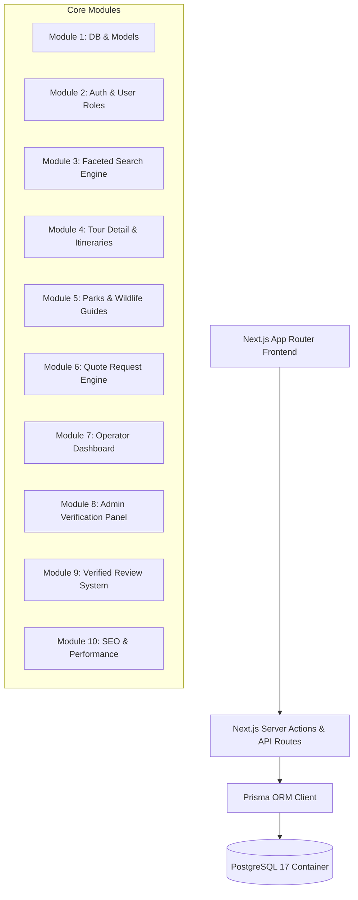

# SafariAsili (SafariBookings Clone) - Master Modular Technical Documentation

## Executive Summary & System Architecture

This final technical blueprint organizes the development of **SafariAsili** (African Safari Marketplace) into **10 decoupled, modular engineering milestones**. 

The system uses **Next.js 14/15 App Router**, **Prisma ORM**, and **Self-Hosted PostgreSQL 17**.



---

## Module Breakdown & Development Plan

---

### Module 1: Database Setup & Prisma ORM Migration
**Objective**: Establish connection to self-hosted PostgreSQL 17 container and initialize Prisma schemas.

* **Files**:
  * `prisma/schema.prisma`
  * `lib/prisma.ts`
* **Data Models Configured**: `User`, `Operator`, `Destination`, `Tour`, `TourDestination`, `TourItinerary`, `Inquiry`, `InquiryLead`, `Message`, `Review`.
* **Verification Checklist**:
  - [ ] `npx prisma db push` executes without errors against PostgreSQL 17.
  - [ ] `npx prisma studio` opens at `http://localhost:5555`.

---

### Module 2: Authentication, User Roles & Sessions
**Objective**: Provide secure multi-role access control for Travelers, Tour Operators, and Admins.

* **Target Pages**:
  * `/app/(auth)/login/page.tsx`
  * `/app/(auth)/register/page.tsx`
  * `/app/(auth)/register/operator/page.tsx`
* **Technical Details**:
  * NextAuth.js v5 / Auth.js integration with Prisma Adapter.
  * Role-Based Access Control (`TRAVELER`, `OPERATOR`, `ADMIN`).
  * Middleware route protection (`/operator-portal/*`, `/admin/*`).
* **Verification Checklist**:
  - [ ] User can register as Traveler or Operator.
  - [ ] Session cookie preserves role upon page navigation.

---

### Module 3: Tour Search & Faceted Filtering Engine
**Objective**: Implement low-latency dynamic search across 10,000+ tour combinations.

* **Target Pages**:
  * `/app/(public)/tours/page.tsx`
* **Components**:
  * `FilterSidebar.tsx` (Country, National Park, Duration, Comfort level, Price range, Travel style, Month).
  * `TourCardGrid.tsx` (Multi-photo preview, starting price, operator badge, review rating).
  * `ActiveFilterBadges.tsx` (Clear individual or all filters).
* **Backend Logic**:
  * PostgreSQL query builder using Prisma `WHERE` filters with indexing on `country`, `comfort_level`, `min_price_usd`, and junction `tour_destinations`.
* **Verification Checklist**:
  - [ ] Changing filter checkboxes updates URL query params and search results dynamically without full page reload.

---

### Module 4: Tour Detail, Interactive Itinerary & Maps
**Objective**: Display rich day-by-day tour itineraries, inclusions/exclusions, and booking call-to-actions.

* **Target Pages**:
  * `/app/(public)/tours/[slug]/page.tsx`
* **Components**:
  * `HeroGallery.tsx` (Lightbox photo modal).
  * `ItineraryAccordion.tsx` (Expandable Day 1 to Day N details with meal indicators & accommodation rating).
  * `InclusionsExclusionsGrid.tsx` (Checkmark/cross list).
  * `ItineraryMap.tsx` (Leaflet.js route visualization connecting national parks).
  * `StickyQuoteModal.tsx` (Pre-filled quote request trigger).
* **Verification Checklist**:
  - [ ] Day accordion expands smoothly; itinerary route pins render on interactive map.

---

### Module 5: National Park & Destination Guides (SEO Engine)
**Objective**: Build high-traffic SEO landing pages with seasonality charts and wildlife checklists.

* **Target Pages**:
  * `/app/(public)/parks/[slug]/page.tsx`
  * `/app/(public)/countries/[slug]/page.tsx`
* **Components**:
  * `SeasonalityGrid.tsx` (12-month visual weather & game-viewing quality grid).
  * `WildlifeGrid.tsx` (Big 5 & rare species availability badges).
  * `ParkToursSection.tsx` (Embedded dynamic tours visiting this park).
* **Verification Checklist**:
  - [ ] 12-month seasonality chart displays high/low season and wildlife viewing ratings.

---

### Module 6: Custom Multi-Operator Quote Request Wizard
**Objective**: Convert travelers into qualified leads dispatched directly to tour operators.

* **Target Pages**:
  * `/app/(public)/quote/request/page.tsx`
* **Multi-Step Wizard**:
  1. *Destinations & Parks selection*
  2. *Travel dates & duration flexibility*
  3. *Traveler counts (Adults & Children)*
  4. *Budget per person & Comfort tier*
  5. *Custom notes / special requests*
  6. *Traveler contact info*
* **Backend Logic**:
  * Create `Inquiry` record.
  * Dispatch `InquiryLead` entries to up to 5 matching operators based on target country and price tier.
* **Verification Checklist**:
  - [ ] Submitting wizard creates inquiry and dispatches lead records to operator inboxes.

---

### Module 7: Operator Portal & Proposal Manager
**Objective**: Allow tour operators to manage leads, send proposals, and update tour packages.

* **Target Pages**:
  * `/app/operator-portal/dashboard/page.tsx` (Lead inbox)
  * `/app/operator-portal/tours/page.tsx` (Tour package CMS)
  * `/app/operator-portal/profile/page.tsx` (Business licensing submission)
* **Components**:
  * `LeadInboxTable.tsx` (Filter leads by status: Dispatched, Viewed, Proposal Sent).
  * `ProposalForm.tsx` (Send custom pricing, itinerary PDF, and message to traveler).
  * `TourBuilderForm.tsx` (Drag-and-drop day-by-day itinerary creator).
* **Verification Checklist**:
  - [ ] Operator can view incoming quote requests and respond with custom pricing.

---

### Module 8: Admin Verification & Moderation Panel
**Objective**: Maintain marketplace security, operator legitimacy, and platform quality.

* **Target Pages**:
  * `/app/admin/verification/page.tsx`
  * `/app/admin/reviews/page.tsx`
* **Components**:
  * `OperatorLicenseViewer.tsx` (Inspect tax & license registration documents).
  * `ReviewModerationQueue.tsx` (Approve or reject submitted traveler reviews).
* **Verification Checklist**:
  - [ ] Admin approval sets `is_verified: true` on operator, unlocking the verified badge on their profile.

---

### Module 9: Verified Review & Rating System
**Objective**: Build trust through verified post-safari traveler feedback.

* **Target Pages**:
  * `/app/(public)/operators/[slug]/reviews/page.tsx`
* **Components**:
  * `ReviewSummaryBar.tsx` (Breakdown for Guide, Vehicle, Value for Money, and Itinerary Accuracy).
  * `ReviewFormModal.tsx` (Multi-criteria star rating & body text).
  * `OperatorReplyBox.tsx` (Allows operators to publish verified responses).

---

### Module 10: Performance Optimization & SEO Standards
**Objective**: Achieve Core Web Vitals targets (LCP < 1.5s, INP < 100ms) and dynamic Google indexing.

* **Deliverables**:
  * `TouristTrip` & `TravelAgency` JSON-LD schema generation.
  * Next.js Dynamic Sitemap (`/app/sitemap.ts`).
  * Image optimization via Next.js `Image` component with `srcset`.

---

## Workspace Directory Blueprint

```
safari-ascili/
├── app/                        # Next.js 15 App Router Directory
├── prisma/
│   └── schema.prisma           # Prisma Schema
├── lib/
│   └── prisma.ts               # Prisma Singleton Client
├── docker-compose.yml          # Self-Hosted PostgreSQL 17
├── .env.example                # Environment variables
├── TECHNICAL_DOCUMENTATION.md  # System Architecture Overview
└── FINAL_TECHNICAL_DOCUMENTATION.md # Modular Development Roadmap
```
