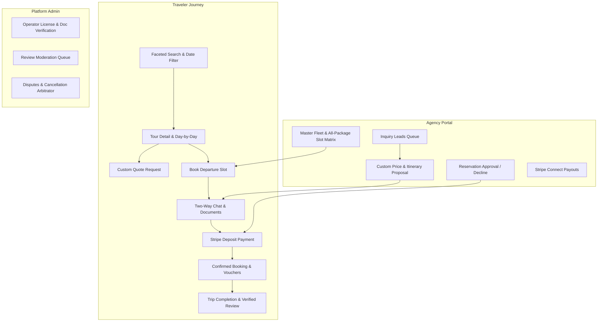
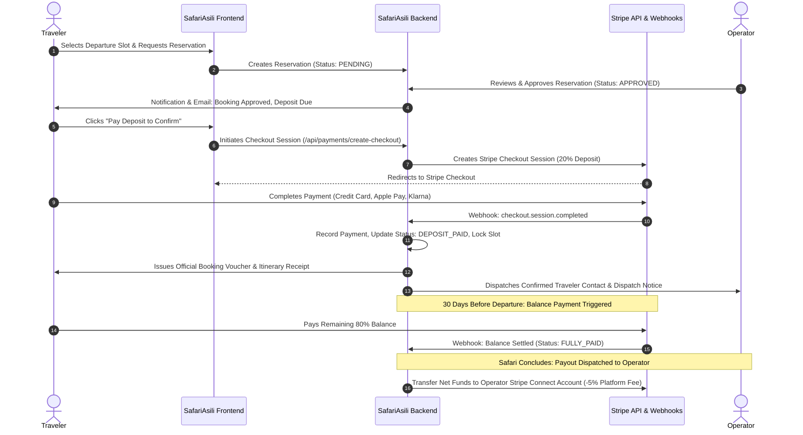
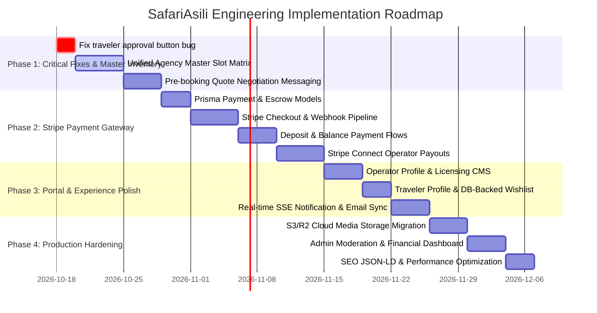

# SafariAsili — Platform Audit, Gap Analysis & Comprehensive Implementation Roadmap

**Document Version:** 2.0  
**Date:** October 2026  
**Target Platform:** SafariAsili (African Safari Marketplace)  
**Stack:** Next.js 15 (App Router), PostgreSQL 17, Prisma ORM, Tailwind CSS, Jose JWT Auth  

---

## 1. Executive Summary & Codebase State

An in-depth inspection of the current SafariAsili codebase revealed substantial architectural foundations already in place:
* **Prisma Schema & Database Models:** Core models for `User`, `Operator`, `Tour`, `Destination`, `TourSlot`, `TourAvailability`, `Inquiry`, `InquiryLead`, `Reservation`, `ReservationMessage`, `Review`, and `Notification`.
* **Public Discovery:** Faceted search engine (`/tours`), tour detail pages (`/tours/[slug]`), national park guide pages (`/parks/[slug]`), and operator directories (`/operators`).
* **Operator Portal (V1):** Basic metrics overview, tour package list, individual tour slot editor, and reservation list table.
* **Traveler Portal (V1):** Booking history (`/my-trips`) and cookie-based favorites (`/favorites`).

However, **critical functional gaps and business logic bottlenecks remain** before SafariAsili can function as a production-grade, commercially viable safari marketplace. This document details the exact missing capabilities, architectural designs, and phased execution roadmaps for:
1. **Agency-wide slot & pooled fleet management** across all packages
2. **Stripe payment gateway integration** (deposits, escrow, payouts)
3. **True two-way real-time communication** (pre-booking quote consultation and post-booking operations)
4. **Traveler userflow & self-service improvements** (including fixing existing UX bugs)
5. **Operator branding, proposals & CMS**
6. **Platform trust, moderation & governance**
7. **Cloud infrastructure, media handling & security**



---

## 2. Core Focus Area 1: Agency-Wide Slot & Fleet Inventory Management

### 2.1 The Problem with the Current Architecture
In the current implementation (`app/operator-portal/slots/page.tsx` and `app/api/tours/[id]/slots/route.ts`):
1. **Siloed Per-Package Slots:** Slots are strictly isolated to single tours (`TourSlot` model: `tourId_startDate`). An operator with 10 packages must navigate 10 separate dropdown items to configure departure dates.
2. **No Unified Agency Master Calendar:** The operator has no view of their total departures across all packages on any given week or month.
3. **No Shared Fleet / Resource Constraints:** In safari tourism, an agency's physical constraints are **vehicles (4x4 safari land cruisers), registered driver-guides, and park concession allocations**—not individual tour marketing titles. If an agency has 4 vehicles (capacity: 28 travelers), they cannot accept bookings exceeding 28 travelers on a single departure date across all 10 of their packages combined.
4. **No Direct Agency Slot Hold / Reservation:** Agencies cannot manually block, hold, or reserve slots for direct offline clients, phone inquiries, or walk-ins without creating fake traveler user accounts.
5. **No Bulk Departure Generator:** Operators cannot generate recurring departures (e.g., "every Monday and Thursday from June 1 to October 31") across multiple packages.

### 2.2 Proposed Solution & Architecture

#### A. Database Schema Enhancements (`prisma/schema.prisma`)
```prisma
// Global Agency Capacity / Fleet Model
model OperatorFleetCapacity {
  id              String    @id @default(uuid())
  operatorId      String    @map("operator_id")
  operator        Operator  @relation(fields: [operatorId], references: [id], onDelete: Cascade)
  departureDate   DateTime  @map("departure_date")
  maxTotalTravelers Int     @default(28) @map("max_total_travelers")
  maxVehicles     Int?      @default(4) @map("max_vehicles")
  isDateBlocked   Boolean   @default(false) @map("is_date_blocked")
  blockedReason   String?   @map("blocked_reason")
  createdAt       DateTime  @default(now()) @map("created_at")
  updatedAt       DateTime  @updatedAt @map("updated_at")

  @@unique([operatorId, departureDate])
  @@map("operator_fleet_capacity")
}

// Agency Manual Slot Hold / Block Model
model SlotHold {
  id            String    @id @default(uuid())
  operatorId    String    @map("operator_id")
  operator      Operator  @relation(fields: [operatorId], references: [id], onDelete: Cascade)
  tourId        String?   @map("tour_id")
  tour          Tour?     @relation(fields: [tourId], references: [id], onDelete: SetNull)
  slotId        String?   @map("slot_id")
  slot          TourSlot? @relation(fields: [slotId], references: [id], onDelete: SetNull)
  departureDate DateTime  @map("departure_date")
  heldTravelers Int       @default(1) @map("held_travelers")
  holdReason    String    @map("hold_reason") // "Offline client booking", "Private vehicle buyout", "Maintenance"
  clientName    String?   @map("client_name")
  expiresAt     DateTime? @map("expires_at")
  createdAt     DateTime  @default(now()) @map("created_at")

  @@map("slot_holds")
}
```

#### B. Operator Portal: Unified Departure Matrix (`/operator-portal/slots`)
Replace the single-tour selector with an **Agency Operations Matrix**:
1. **Monthly Master Departure Calendar:** Visual grid displaying every active package departure on each calendar day, color-coded by capacity status (Green: Open, Yellow: Filling fast, Red: Full, Gray: Blocked).
2. **Aggregated Agency Day Load:** Visual indicator showing total booked travelers across all packages versus the agency's fleet capacity for that day.
3. **1-Click Slot Actions:**
   - **Quick Hold:** Reserve $N$ seats on a date for an offline client or phone reservation.
   - **Blackout Date:** Block out dates for rainy seasons, vehicle maintenance, or private buyouts.
   - **Capacity Adjustment:** Override seat caps on specific peak-demand dates.
4. **Batch Recurring Slot Generator:**
   - Select multiple packages (e.g., 5-day Serengeti + 7-day Migration).
   - Frequency: Weekly, bi-weekly, or custom days of the week.
   - Date range selector with seasonal traveler cap.

---

## 3. Core Focus Area 2: Payment Gateway Architecture (Stripe)

### 3.1 Current Status & Gap
The site currently has zero payment handling. Bookings are submitted as non-monetary requests, with a note informing travelers that payment will be arranged later. This leads to high abandonment, non-serious booking spam, and zero marketplace monetization.

### 3.2 Marketplace Monetization & Payment Flow



### 3.3 Database Models for Payments (`prisma/schema.prisma`)
```prisma
enum PaymentStatus {
  PENDING
  SUCCEEDED
  FAILED
  REFUNDED
  PARTIALLY_REFUNDED
}

enum PaymentType {
  DEPOSIT
  BALANCE
  FULL
  CANCELLATION_FEE
}

model Payment {
  id                    String        @id @default(uuid())
  reservationId         String        @map("reservation_id")
  reservation           Reservation   @relation(fields: [reservationId], references: [id], onDelete: Cascade)
  travelerId            String        @map("traveler_id")
  traveler              User          @relation(fields: [travelerId], references: [id], onDelete: Cascade)
  amountUsd             Float         @map("amount_usd")
  currency              String        @default("usd")
  paymentType           PaymentType   @map("payment_type")
  status                PaymentStatus @default(PENDING)
  stripePaymentIntentId String?       @unique @map("stripe_payment_intent_id")
  stripeCheckoutSessionId String?     @unique @map("stripe_checkout_session_id")
  receiptUrl            String?       @map("receipt_url")
  createdAt             DateTime      @default(now()) @map("created_at")
  updatedAt             DateTime      @updatedAt @map("updated_at")

  @@index([reservationId])
  @@map("payments")
}

model OperatorStripeAccount {
  id                    String    @id @default(uuid())
  operatorId            String    @unique @map("operator_id")
  operator              Operator  @relation(fields: [operatorId], references: [id], onDelete: Cascade)
  stripeAccountId       String    @unique @map("stripe_account_id")
  chargesEnabled        Boolean   @default(false) @map("charges_enabled")
  payoutsEnabled        Boolean   @default(false) @map("payouts_enabled")
  detailsSubmitted      Boolean   @default(false) @map("details_submitted")
  createdAt             DateTime  @default(now()) @map("created_at")
  updatedAt             DateTime  @updatedAt @map("updated_at")

  @@map("operator_stripe_accounts")
}
```

### 3.4 Key Implementation Deliverables
1. **Packages Required:** `stripe` (server SDK) and `@stripe/stripe-js` (client SDK).
2. **API Routes:**
   - `POST /api/payments/create-checkout`: Creates session for deposit (typically 20% or 30%) or full trip total.
   - `POST /api/payments/webhook`: Listens to `checkout.session.completed`, `payment_intent.payment_failed`, and `charge.refunded`. Verifies `stripe-signature` header.
   - `POST /api/operator/stripe-connect`: Onboarding link generation for agencies using Stripe Connect Express.
3. **Escrow & Refund Policy Engine:**
   - 100% refund if cancelled > 60 days before start.
   - 50% refund if cancelled 30-60 days before start.
   - Non-refundable within 30 days (park permit fees are non-refundable by TANAPA/KWS).
   - Automated refund calculation triggered from cancellation requests.

---

## 4. Core Focus Area 3: Bidirectional Two-Way Communication System

### 4.1 Current Limitations
* The `InquiryLead` system currently dispatches quote requests, but operators cannot reply inside the platform. Leads are dead ends unless the operator emails outside the system.
* Existing messages (`ReservationMessage`) are tied strictly to an already-created reservation, meaning pre-booking negotiations are impossible inside the portal.
* No live updates: users must manually refresh pages to see replies.
* No attachment support: travelers cannot send flight arrival passes, and operators cannot send custom PDF itineraries or park waivers.
* `lib/email.ts` currently prints to `console.log` and does not dispatch real emails.

### 4.2 Comprehensive Messaging Redesign

```mermaid
graph LR
    subgraph Channels
        C1[Quote Consultation Thread]
        C2[Active Reservation Thread]
        C3[Post-Trip Support]
    end

    subgraph Communication Engine
        SSE[Real-Time Server-Sent Events / SSE Stream]
        Attachments[Signed Document Uploads S3/R2]
        EmailSync[Transactional Email Relays via Resend]
        BadgeSync[Unread Counter & Navbar Badges]
    end

    C1 --> Communication Engine
    C2 --> Communication Engine
    C3 --> Communication Engine
```

### 4.3 Actionable Technical Upgrades
1. **Unify Chat across Quotes and Reservations:**
   - Allow conversations to initiate on **Quote Inquiries** (`InquiryLead`) with a "Send Proposal" action.
   - When the traveler agrees, the agency clicks "Convert Proposal to Booking", creating a `Reservation` with the agreed dates and custom pricing, seamlessly continuing the conversation thread.
2. **Real-time Updates via Server-Sent Events (SSE) or WebSockets:**
   - Route: `/api/messages/stream?threadId=[id]`
   - Push new messages instantly to open browser tabs without polling overhead.
3. **File Attachments & Proposals:**
   - Allow sending `.pdf`, `.png`, and `.jpg` files up to 10MB (flight itineraries, visa copies, customized day-by-day PDFs).
4. **Live Transactional Email Notifications:**
   - Integrate **Resend** or **AWS SES** in `lib/email.ts`.
   - Send instant email alerts with direct reply buttons when a new message is received.
5. **Operator Message Templates / Quick Replies:**
   - Pre-canned responses in operator portal: "Safari Packing Checklist", "Airport Arrival Instructions", "Dietary Form Request".

---

## 5. Core Focus Area 4: Traveler Userflow & UX Improvements

### 5.1 Critical UX Bug Identified During Code Audit
In `app/my-trips/page.tsx` (lines 298–313):
```tsx
// BUG IN CODEBASE:
{trip.status === 'PENDING' && (
  <div className="surface-card rounded-2xl border border-black/5 p-5 shadow-sm">
    <p className="text-xs sm:text-sm text-[var(--ink-muted)] mb-3">
      Awaiting agency decision — approve or decline to move forward.
    </p>
    <div className="flex gap-2">
      <button onClick={() => decide('APPROVED')} ...>Approve</button>
      <button onClick={() => decide('DECLINED')} ...>Decline</button>
    </div>
  </div>
)}
```
* **Impact:** The **traveler** is shown the operator's decision buttons ("Approve" / "Decline") on their own booking! Clicking them triggers a 401 error because the backend requires operator credentials.
* **Correction Required:** Replace this with a traveler status card: `"Your reservation request has been submitted to the agency. Awaiting operator confirmation."` plus a `"Cancel Request"` button for the traveler.

### 5.2 Key Traveler UX Upgrades
1. **Traveler Account Settings & Profile (`/account/profile`):**
   - Editable traveler details: Passport name, emergency phone, nationality, dietary requirements (vegan, halal, gluten-free), and medical notes.
2. **Interactive Map Component (`tours/[slug]`):**
   - Leaflet / Mapbox visual route connecting Arusha -> Tarangire -> Ngorongoro -> Serengeti with day-by-day route pins.
3. **Smart Search with Real-Time Slot Filtering (`/tours`):**
   - Currently, the search filter only filters by generic string matches. It must query the `tour_slots` table so travelers can filter for tours departing on specific dates (e.g., "Departing between July 15 and July 25 with at least 2 open spots").
4. **Transparent Pricing Breakdown:**
   - Clear breakdown in `ReserveDialog` and `BookingBox`:
     * Base package rate $\times$ adults
     * Child discount (50%)
     * Single supplement fee (if 1 adult in private room)
     * National park conservation fees breakdown (TANAPA/KWS)
5. **Database-Backed Favorites:**
   - Migrate favorites from local cookie storage to a `UserFavorite` database relation for authenticated users, preserving wishlist tours across devices.
6. **Post-Trip Review Verification Flow:**
   - Restrict reviews so that only travelers with a `COMPLETED` reservation can review an operator.
   - Multi-factor rating criteria: Vehicle condition, guide expertise, food & lodge quality, wildlife sightings, value for money.

---

## 6. Core Focus Area 5: Operator Portal & Agency CMS Gaps

### 6.1 Missing Agency Profile & Licensing CMS
Currently, there is no way for an operator to edit their company details, logo, banner, or upload official business licenses via the UI.
* **New Route Needed:** `/operator-portal/profile`
* **Features:**
  - Company logo & hero banner upload.
  - Licensing documentation upload (TALA license in Tanzania, KATO certificate in Kenya, TRA tax compliance).
  - Operator vehicle fleet specs (pop-up roof Land Cruisers, Wi-Fi on board, onboard fridges).
  - Guide qualifications and languages spoken (English, French, German, Spanish).

### 6.2 Tour Package Builder Enhancements
* Drag-and-drop daily itinerary sequence reordering.
* Accommodation database picker (lodges & tented camps linked to national parks).
* Batch photo uploader with cover photo selector and captioning.

### 6.3 Quote Proposal Generator
* When an inquiry arrives, the agency should be able to click **"Create Custom Proposal"**:
  - Adjust base pricing per person.
  - Add or remove days.
  - Attach a generated branded proposal PDF.
  - Send directly to the traveler's inquiry thread.

---

## 7. Core Focus Area 6: Platform Trust, Moderation & Admin Panel

### 7.1 Review Moderation Queue (`/admin/reviews`)
* Currently, `POST /api/reviews` automatically sets `status: 'APPROVED'`, bypassing moderation.
* **Correction:** Unverified reviews must be placed in `PENDING_MODERATION`. Verified bookings can be auto-approved, while flagged reviews enter the admin queue for sentiment analysis and profanity checks.

### 7.2 Operator KYC & Verification Desk (`/admin/operators`)
* Workflow for admins to review uploaded PDF business licenses, verify government registration numbers, and grant the **"Verified Agency"** metallic gold badge.

### 7.3 Financial Reporting & Commission Desk
* Marketplace dashboard tracking:
  - Gross Booking Value (GBV)
  - Net Platform Revenue (commission earned)
  - Escrow balance currently held
  - Operator payout batch disbursements

---

## 8. Core Focus Area 7: Technical Infrastructure, Security & SEO

| Area | Current State | Target Production Architecture |
| :--- | :--- | :--- |
| **Media Assets** | Binary image bytes stored in PostgreSQL `bytea` (`MediaAsset.data`) | Cloudflare R2 or AWS S3 with pre-signed upload URLs and CDN edge caching |
| **Email Service** | `console.log` stub in `lib/email.ts` | Resend or Postmark API with responsive React-email templates |
| **Authentication** | Custom Jose JWT cookie without refresh tokens | Add token refresh rotation, CSRF verification, and password reset flow |
| **Rate Limiting** | None | Upstash Redis or memory token bucket on `/api/auth/*`, `/api/inquiries`, and `/api/reservations` |
| **SEO & Schema** | Partial OpenGraph tags | Full JSON-LD (`TouristTrip`, `OfferCatalog`, `AggregateRating`, `FAQPage`) and auto-generated XML sitemaps |

---

## 9. Prioritized Phased Implementation Plan



### Phase 1: High Priority Core Foundations & UX Fixes
1. **Fix Traveler UX Bug in `/my-trips`:** Remove operator Approve/Decline buttons from traveler view; replace with status stepper and cancellation action.
2. **Agency Master Slot & Fleet Calendar:** Implement `OperatorFleetCapacity` and a unified monthly matrix view in `/operator-portal/slots`.
3. **Pre-Booking Chat on Inquiries:** Wire up `InquiryLead` messaging so agencies can communicate with potential clients prior to reservation creation.
4. **Live Transactional Email:** Replace mock email logger with Resend for lead dispatches and booking notifications.

### Phase 2: Stripe Payment Gateway & Escrow
1. **Schema & Models:** Create `Payment`, `PaymentIntent`, and `OperatorStripeAccount` tables.
2. **Stripe Checkout Integration:** Deposit flow (20% to lock reservation) + automated balance collection.
3. **Webhooks Engine:** Reliable webhook handler with idempotency and state synchronization.
4. **Stripe Connect:** Multi-vendor payouts and platform fee collection.

### Phase 3: Operator CMS & Traveler Experience
1. **Operator Branding CMS (`/operator-portal/profile`):** Logo, banner, licensing doc upload, and fleet overview.
2. **Traveler Profile & Preferences (`/account/profile`):** Passport details, dietary preferences, and database-backed wishlist.
3. **Proposal Generator:** Operators can send custom prices and customized itineraries directly to inquiry leads.
4. **Verified Review Gating:** Require completed trips for review creation; expand review rating criteria.

### Phase 4: Production Scaling, Cloud Storage & SEO
1. **Cloudflare R2 / S3 Media Migration:** Move binary image storage from PostgreSQL `bytea` to object storage with CDN edge caching.
2. **Admin Moderation & Finance Desk:** Operator license verification, review moderation queue, and financial reporting.
3. **Performance & SEO:** Dynamic OpenGraph image generation, JSON-LD Schema on all destination and tour pages, rate limiting on sensitive routes.
