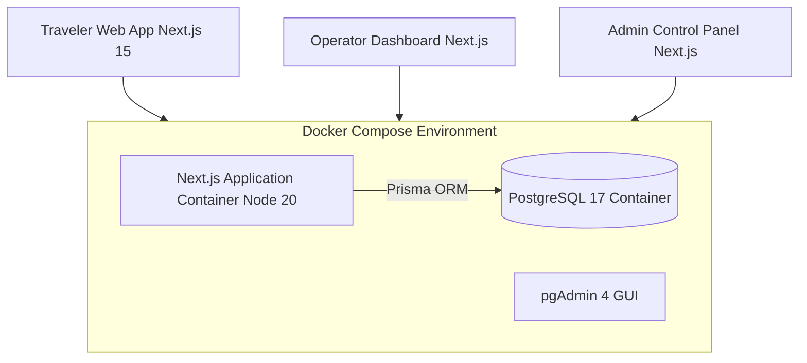

# SafariAsili (SafariBookings Clone) - Master Technical Documentation

## 1. Executive Summary & Architecture Overview

This technical documentation specifies the exact architecture, database design, Docker setup, and Next.js + Prisma framework configuration for **SafariAsili**.

The platform is designed as a multi-tenant safari lead marketplace connecting **Travelers**, **Verified African Tour Operators**, and **Platform Admins**.



---

## 2. Integrated Skills & Design System Engineering

This project incorporates four specialized AGY design and engineering skills:

### 1. `frontend-design` (Distinctive, Production-Grade UI)
- **Aesthetic Direction**: *Authentic African Luxury & Earthy Warmth*. Avoids generic corporate blue templates.
- **DFII (Design Feasibility & Impact Index) Score**: **14 / 15** (Excellent).
- **Curated Color Tokens**:
  - Kalahari Terracotta (`#b84a12` / `#c85a17`): Primary action CTAs and badges.
  - Savannah Gold (`#d4af37` / `#e48901`): Metallic rating stars & verified badges.
  - Great Rift Emerald (`#1c402e`): Deep forest green for trust elements & nature headers.
  - Obsidian Slate (`#121212` / `#1e1e1e`): Readable high-contrast typography.
  - Soft Sand (`#f8f6f0`): Warm spacious backgrounds.

### 2. `nextjs-app-router-patterns` (Full-Stack Architecture)
- Next.js 14/15 App Router with Server Components for direct Prisma data fetching.
- Client Components for interactive search filters and multi-step forms.
- `<Suspense>` boundaries for `useSearchParams` handling during static generation.

### 3. `typescript-pro` (Strict Type Safety)
- Type-safe Prisma ORM schemas, Next.js API routes, and React component props.

### 4. `design-to-code` (Responsive Systems & WCAG Accessibility)
- Responsive mobile-first drawer navigation, sticky CTA bars, high-contrast text.

---

## 3. Docker Self-Hosted Setup (PostgreSQL 17)

The workspace includes a simplified, robust `docker-compose.yml` configured to run PostgreSQL 17 (latest stable release) on your local or cloud Linux host.

### Quick Start Commands
```bash
# 1. Start PostgreSQL 17 in background
docker compose up -d

# 2. Verify container health status
docker compose ps

# 3. Push Prisma schema & seed database
npx prisma db push
npx prisma db seed

# 4. Start Next.js server
npm run dev
```

---

## 4. Master Checklist

See [`CHECKLIST.md`](file:///home/saad/Desktop/CoachAI/safari-ascili/CHECKLIST.md) for the complete step-by-step progress and verification status.
